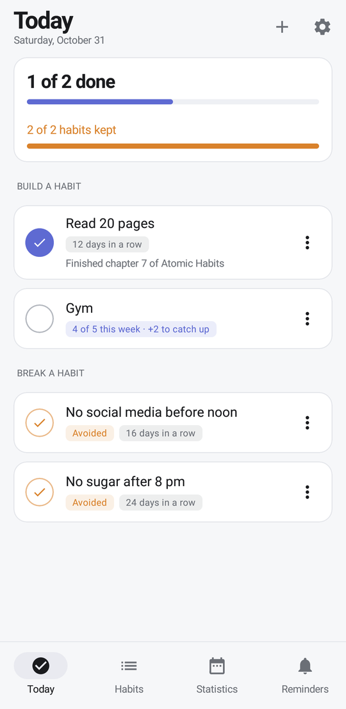
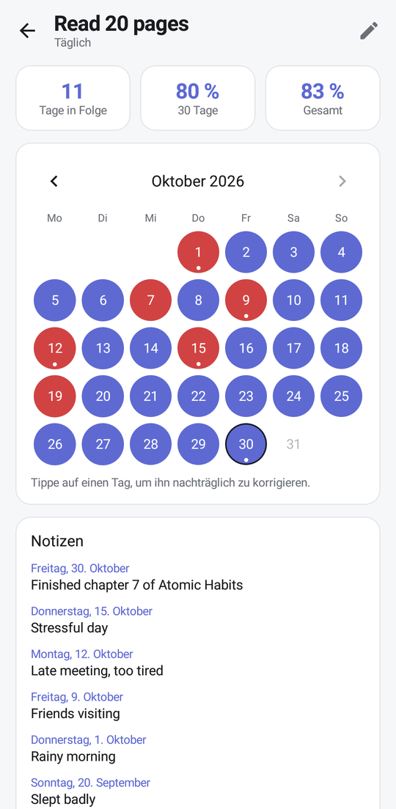
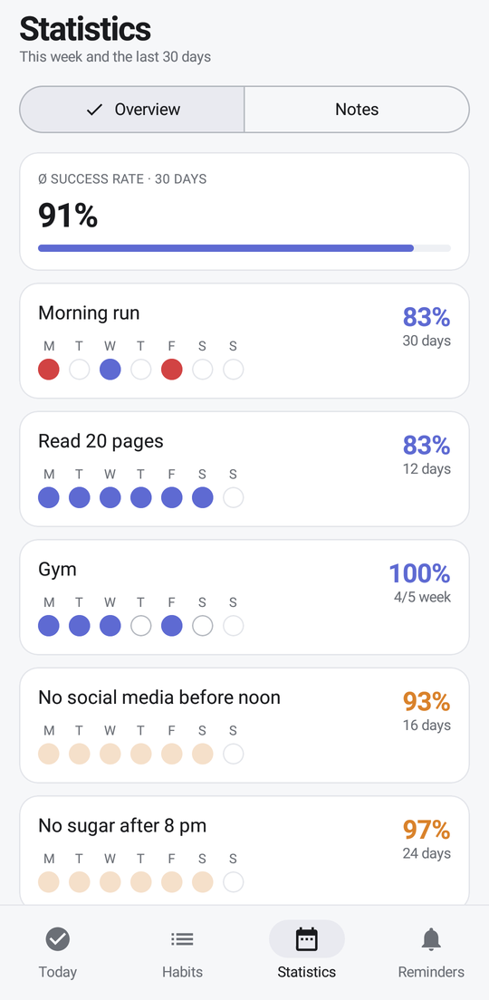
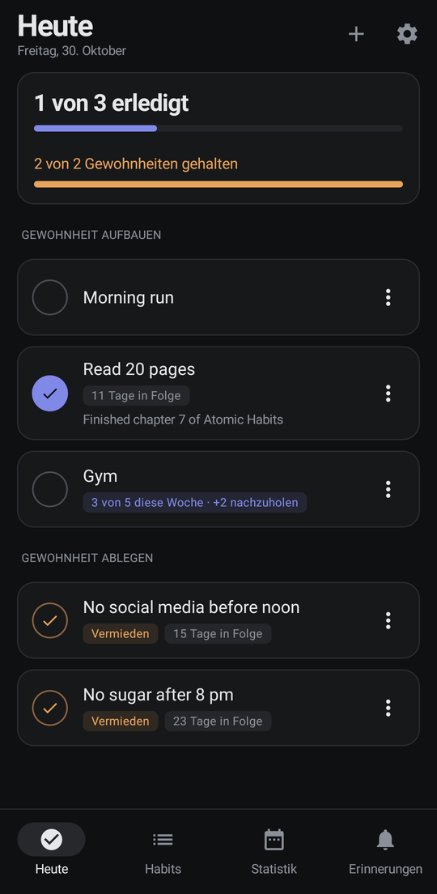
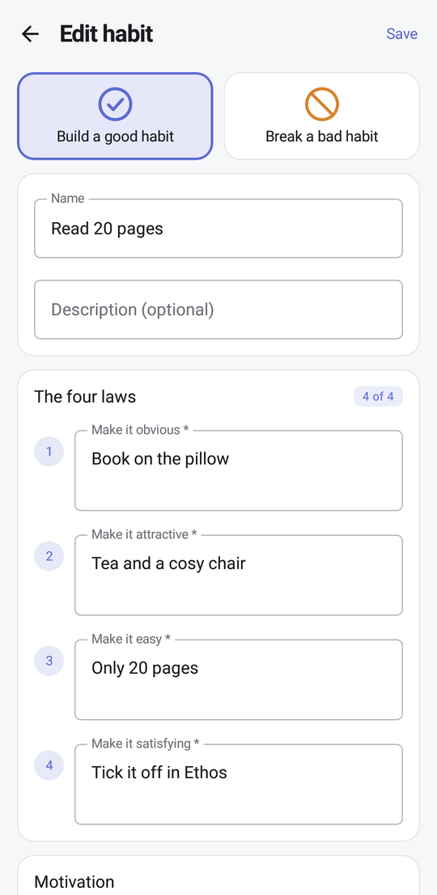
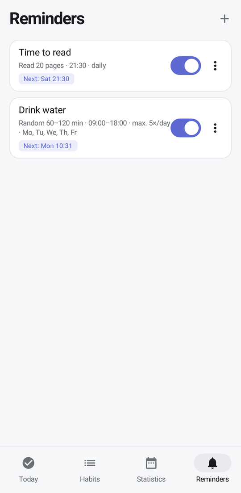

# Ethos

**A minimalist habit tracker for Android, built around the four laws of behavior change.**

Build good habits, break bad ones, and see honestly how you are doing. No account, no cloud, no ads.
All data stays on your device.

<p align="center">
  
  
  
  
</p>

<p align="center">
  <a href="https://github.com/ItsDylan255/Ethos/releases/latest"><b>Download the latest APK</b></a>
</p>

## Features

### Two kinds of habits
- **Build** a good habit: tick it off when it is done, or mark it as not done.
- **Break** a bad habit: every day counts as avoided unless you log that you did it anyway.

### The four laws
Every habit asks for a concrete personal strategy for each law, inspired by *Atomic Habits*:

| Build a habit | Break a habit |
| --- | --- |
| Make it obvious | Make it invisible |
| Make it attractive | Make it unattractive |
| Make it easy | Make it difficult |
| Make it satisfying | Make it unsatisfying |

Add a personal motivation as well. Ethos shows it to you when you missed a habit once.

### Flexible schedules
- Daily, on selected weekdays, or **several times per week** with an optional catch-up for missed sessions
- Optional start and end date
- **Skip** a day, for example when you are sick. Skipping always asks for a short reason.
- **Move** a day of a fixed-weekday habit to another day

### Today at a glance
- One list for the day, split into habits to build and habits to break
- Streaks, weekly progress, and a short note per day
- **Never miss twice:** a gentle hint when a habit slipped yesterday
- A small completion sound that follows your media volume

### Honest statistics
- Current streak, success rate over 30 days and overall
- Monthly calendar per habit: tap any day to correct it afterwards
- All notes in one place, so you can spot patterns in why things did not work
- **Reset statistics** for a habit without losing its name, description, motivation or strategies

### Reminders
- Fixed times, a fixed interval, or a random interval within a time window
- Daily limit, snooze and pause
- Optional daily overview notification and a motivation notification for missed habits

### Wear OS companion
For Wear OS 3+ watches such as the Galaxy Watch 4 to 7. The phone stays the only place where data lives;
the watch shows today and sends taps back.
- **Today list:** tick off habits right on your wrist, with a short vibration
- **Tile:** today's progress ring and what is still open, one swipe away from the watch face
- **"Erledigt" button** on habit reminders, on the phone and on the watch

### Your data
- **Backup and restore** as a JSON file
- **Export as a table (CSV)** for analysis: one row per habit and day with status, success (1/0) and note.
  Opens directly in Excel or LibreOffice; in pandas use `pd.read_csv(path, sep=None, engine="python", encoding="utf-8-sig")`.
  Columns and values follow the app language (semicolons in German, commas in English).
- Light, dark and system theme, plus Material You colors on Android 12 and newer
- **English and German**: follows the system language, or pick one under *Settings → Language*

<p align="center">
  
  
</p>

## Installation

1. Download `Ethos-1.1.1.apk` from the [latest release](https://github.com/ItsDylan255/Ethos/releases/latest).
2. Open it on your phone and allow installing apps from this source when Android asks.

Requires Android 8.0 (API 26) or newer.

### Watch app
The watch app is not on the Play Store, so it is installed over ADB:

1. On the watch: *Settings → About watch → Software* and tap *Software version* five times to enable developer options.
2. *Settings → Developer options*: turn on *ADB debugging* and *Wireless debugging*, then tap *Pair new device*.
3. On your computer (Android platform tools):

```bash
adb pair <ip>:<pairing-port>
adb connect <ip>:<port>
adb install Ethos-Wear-1.1.1.apk
```

Phone and watch apps must come from the same build (same signing key), otherwise they cannot talk to each other.

## Building from source

1. Open the project in Android Studio (Ladybug or newer).
2. Let Gradle sync (JDK 17 or 21, Gradle 8.9).
3. Run the `app` configuration on a device or emulator.

From the command line:

```bash
gradle :app:assembleDebug
```

## Tech stack

Kotlin · Jetpack Compose · Material 3 · Room · DataStore · AlarmManager

| Folder | Contents |
| --- | --- |
| `data/` | Room entities, DAOs and database, repository, settings, backup and CSV export |
| `domain/` | Pure logic: `HabitLogic` (build/avoid, streaks, success rates), `ReminderPlanner` |
| `reminders/` | Alarms, notifications, boot and time-change receivers |
| `ui/` | Compose screens per area (Today, Habits, Statistics, Reminders, Settings) and their view models |
| `watch/` | Sync with the watch over the Wearable Data Layer |
| `wear/` (module) | Wear OS app: Today list, tile |
